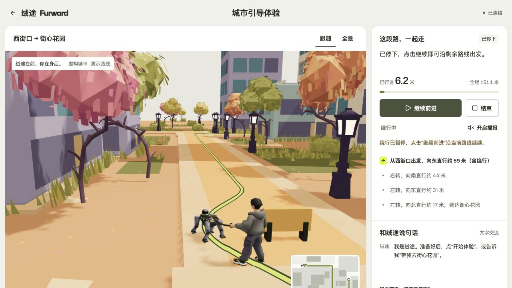

# 绒途 Furward · 机器导盲犬项目

绒途把品牌首页、内容管理后台和三维城市引导体验整合为一个可本地运行、可独立部署的项目。人物握着连接机器狗胸背带的牵引绳，沿“西街口 → 街心花园”路线前进；遇到障碍后从旁边绕行，障碍保留原位。

[品牌首页](https://8.147.109.174:8088/) · [城市体验](https://8.147.109.174:8088/experience)



## 功能

- 品牌首页三段动效，以及中文内容和图片管理后台。
- 三维城市、人物与机器狗骨骼动画、牵引绳和较低的跟随视角；支持全景查看。
- 开始、暂停、继续、结束与重新体验；遇障绕行后同步更新地图、步骤和实际里程。
- 文字指令、浏览器语音播报、独立访客会话，以及刷新和断线后的状态恢复。
- 保留原机器人后端、手机调试代码、T1 桥接和可编辑 Blender 工程。

网站中的路线是固定城市场景的仿真演示。统一启动入口不会连接真实机器狗，也不需要 AI API Key；真机程序在独立目录中另行运行。

## 本地启动

需要 Node.js 24 或更新版本，以及 Python 3.10 或更新版本。首次启动会安装依赖，需要联网。

```sh
git clone https://github.com/xcm1008611/furward-integrated.git
cd furward-integrated/furward-integrated
npm start
```

仓库内保留了原有的 `furward-integrated/` 工程子目录，因此上述路径包含两层同名目录。Mac 用户也可以打开工程子目录，双击 `启动绒途.command`。

启动后访问 [首页](http://localhost:3000/)、[城市体验](http://localhost:3000/experience) 或 [管理后台](http://localhost:3000/admin)。同一 Wi-Fi 下的设备使用启动窗口打印的局域网地址；保持启动窗口打开，按 `Ctrl+C` 停止。

首次运行会生成本地管理员配置，登录信息保存在工程的 `.runtime/管理员登录信息.txt`。真实 API Key、管理员凭据、数据库、上传资料和其他运行配置均不在本仓库中；`.env.example` 是配置模板。

## 工程目录

以下路径均位于 `furward-integrated/` 内。

| 目录 | 内容 |
| --- | --- |
| `web/` | 首页、内容后台、城市体验和公开模型资产 |
| `demo-service/` | 城市路线、会话隔离、绕行与实时状态服务 |
| `shared/` | 共用路线、坐标及固定场景碰撞轮廓 |
| `robot/` | 原机器人后端、手机调试与 T1 桥接 |
| `source-assets/` | 原城市资料、角色与可编辑 Blender 工程 |
| `scripts/`、`deploy/` | 启动、导出、验证和独立部署 |
| `docs/` | 接口说明、模型说明、截图与验收记录 |

## 说明与验证

- [完整启动与协作说明](furward-integrated/README.md)
- [整合说明与验收](furward-integrated/docs/整合说明与验收.md)
- [城市演示 API](furward-integrated/docs/demo-api.md)
- [模型动画说明](furward-integrated/docs/模型动画说明.md)
- [独立公网部署](furward-integrated/docs/公网部署说明.md)
- [本轮持绳、绕行与视角验收记录](furward-integrated/docs/verification/guide-detour-release.json)

当前版本已记录后端 47 项、前端 21 项检查通过，本地及真实公网完整路线到达 151.1078 米。详细证据及各次测试范围见上述文档；这些软件与浏览器检查不代表实体机器狗已经完成现场导盲验证。
