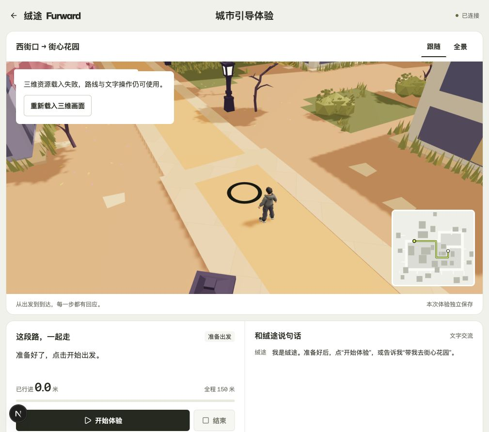
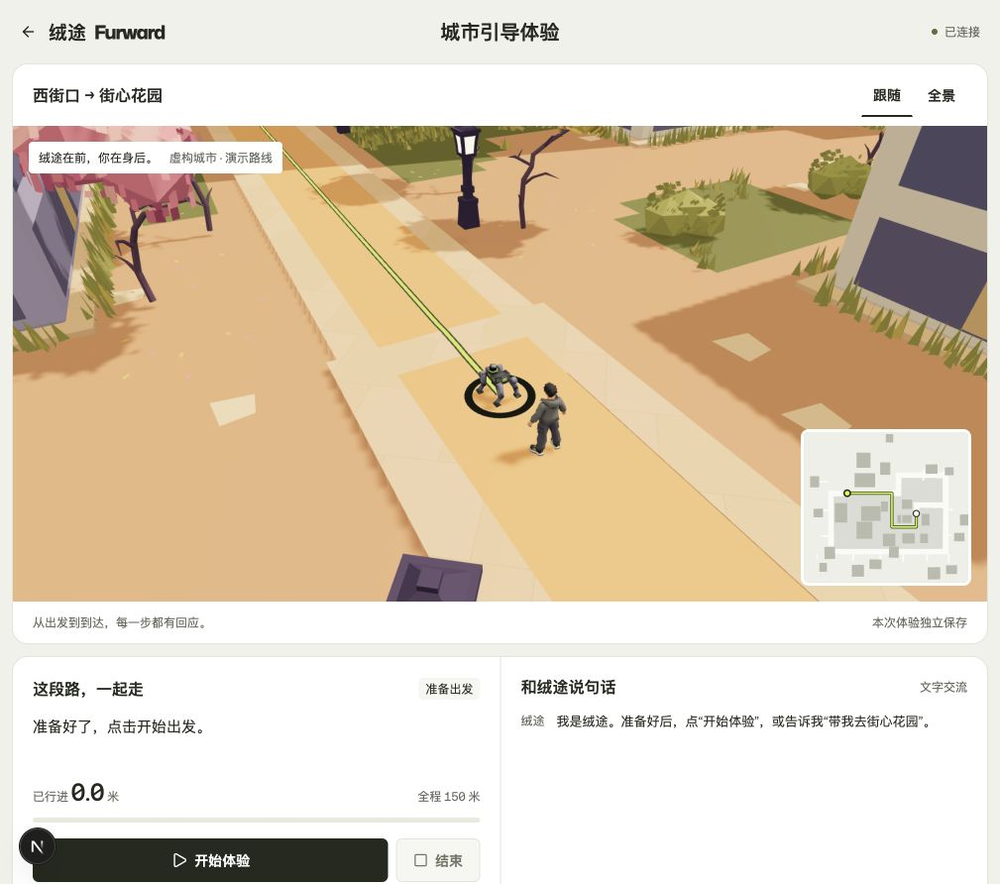

# 交互、断网与模型故障复核

日期：2026-10-25。以下是在原整合验收之后追加的针对性检查；不代表公网安全组已经开放，也不代表物理手机或实体机器狗已测试。

后续状态：同日 05:33 经用户确认开放公网入口，[公网完整路线](public-full-route.log)及浏览器验收已通过；用户另确认手机显示、操作和播报正常，见[手机反馈记录](mobile-user-feedback.json)。下表保留各项原始检查的范围。

| 场景 | 检查方式与结果 |
| --- | --- |
| 连接失活但没有关闭通知 | 独立本机 TCP 代理双向吞掉数据，不发送 FIN/RST。15.16 秒识别失活，25.14 秒在 29.998 米暂停；同身份重连后仍暂停，手动继续成功 |
| 每条连接独立过期 | 旧连接不能被新连接的心跳续期；HTTP 请求不能维持旧 WS 的存活期限 |
| 迟到的旧请求 | 实际 React hook 测试确认旧会话 HTTP/WS 成功、错误与关闭回调不能覆盖新会话，也不能解除新请求的忙碌状态 |
| 键盘连续操作 | 真实 Chrome 检查开始、暂停、发送后焦点仍留在原按钮；四秒响应延迟下连续 Enter/Space 与交叉文字操作没有重复请求 |
| 相同文字回复 | 每次回复具有新的通知事件，单个 polite live region 更新；没有重复朗读全部历史。未测试实际读屏软件 |
| 语音失败 | 对 voice-unavailable、audio-busy、synthesis-failed、not-allowed、同步异常与迟到错误测试通过；失败后回到文字提示并允许重试。真实浏览器开关正常，未做硬件听音验证 |
| 模型请求失败 | 独立代理将机器狗 GLB 首次请求返回 503。页面显示错误与重试操作，文字指令仍可用；实际点击重试后模型和绿色路线恢复，错误消失 |
| 窄屏 | 桌面浏览器 320px 视口没有横向溢出；输入字号 16px、主要触控目标 44–48px。此项不是物理手机测试 |
| 高刷新率屏幕 | 在独立源码副本上测量：原始回调约 120Hz，行进、暂停、全景实际渲染约 60fps；19.15 秒行进样本速度 1.1996 米/秒，符合 1.2 米/秒设定 |
| 切换后台再回来 | 原生 Chrome 标签实际隐藏 11.74 秒与 13.57 秒，隐藏期间均渲染 0 帧；恢复首帧时间差为 0。行进恢复只使用当前服务状态和约 0.095 米正常插值，暂停恢复距离保持不变 |

服务测试共 **30 项通过**。前端会话竞态 **6 项**、语音适配器 **5 项**、路线几何 **1 组**及帧率时钟 **4 项**通过；这些检查口径不同，分别记录。

复查命令：

```sh
(cd demo-service && .venv/bin/python -m pytest -q)
(cd web && node --test scripts/test-demo-session.mjs scripts/test-demo-speech.mjs scripts/test-demo-route.mjs scripts/test-demo-frame-clock.mjs)
```

`test_blackhole.py` 会启动自己的临时服务和本机代理，实际等待约 25 秒，不重启日常运行的站点。所有临时故障代理在检查后关闭。





动画新增的脚底约束与 Blender 直线验证见[模型动画说明](../模型动画说明.md)。

帧率原始记录见 [frame-rate-and-visibility.json](frame-rate-and-visibility.json)。该测量使用独立开发副本；测试 HUD 和临时服务已清理，正式源码只保留帧率时钟及可见性恢复逻辑。浏览器进入后台并不等于网络断开：连接仍有效时，服务端路线可以继续；连接失活时按心跳规则暂停。
