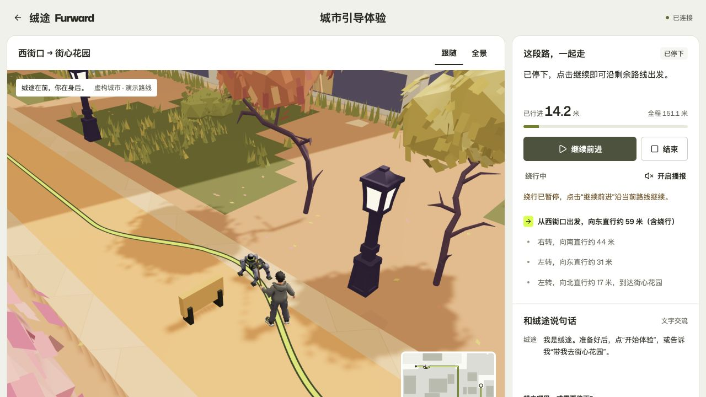
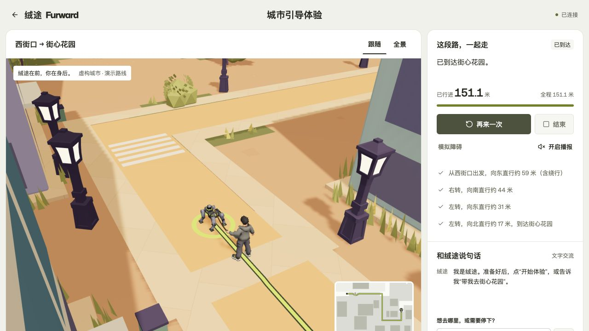
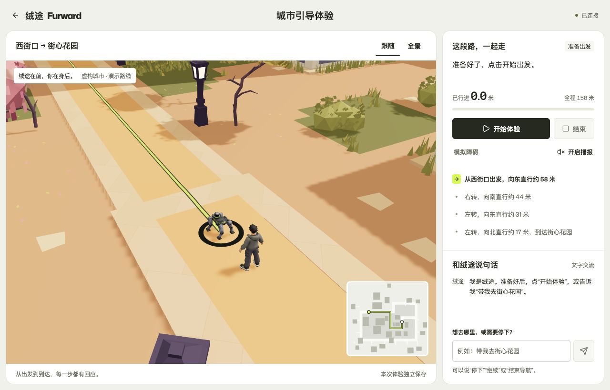
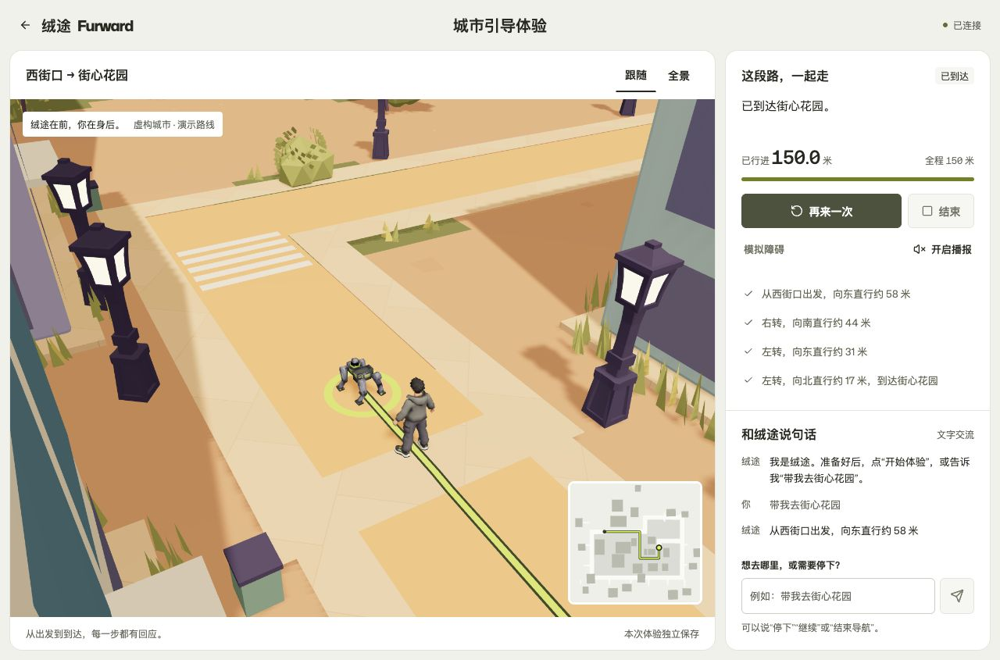

# 绒途 Furward 整合说明与验收

记录日期：2026-10-25。本文说明各同学交付内容如何放到一起、目前能演示什么，以及哪些验证已经完成。本轮运行时导盲绳与局部绕行已通过本地生产、公网完整路线及浏览器联动验收，见[本轮汇总](verification/guide-detour-release.json)。更新前的手机用户反馈、独立 Linux 客户端及固定 150 米路线记录另作历史保留，不替代本轮结果；最后的低视角相机微调单独标明检查范围。

## 1. 本次整合结果与文件来源

本工程把品牌首页作为统一入口，提供城市体验和中文内容后台。城市体验由独立仿真服务提供进度，人物和机器狗沿统一路线同步移动。原机器人程序保留为单独子项目，现阶段不接受公网城市体验的控制。

| 原交付包 | 在整合项目中的作用 | 取舍 |
| --- | --- | --- |
| `绒途Furward-首页三段动效版-2026-10-25.zip` | 品牌首页、三段动效、内容管理后台 | 在 `web/` 延续，新增城市体验入口 |
| `城市网页交付_v10.zip` | 城市、外围环境、原人物与机器狗、碰撞资料 | 页面使用公开资产，原交接资料保留在 `source-assets/city/` |
| `ver2.zip` | 原机器狗后端、手机交互、导航与桥接 | 作为 `robot/` 的代码基线，保留结束导航修复与城市演示数据 |
| `后端.zip` | 同一后端的较早交付 | 用于比较参考；不覆盖更新代码，不继承其虚拟环境、缓存或私密 `.env` |

`ver2.zip` 已包含较新的导航结束处理、城市底图和固定路线，旧后端包没有需要另外合入的独有业务源码。新网站中的城市仿真采用新增服务，不通过取消原后端的室外运动限制来实现。

## 2. 启动后各部分如何配合

本地统一入口为 [http://localhost:3000/](http://localhost:3000/)。首页是 `/`，城市体验是 `/experience`，内容管理后台是 `/admin`。

当前物理网卡 `en0` 的地址是 [http://172.168.23.102:3000/experience](http://172.168.23.102:3000/experience)。更新前版本的本机基础检查和独立 Linux 虚拟客户端完整路线验收均已通过，覆盖 HTTP、WS、双访客隔离、Origin、会话鉴权、暂停重连及 150 米路线（125.7 秒）。该客户端运行在 Docker Desktop 的 Linux 虚拟机中，通过宿主机网络转发访问此地址；它验证了独立运行环境下的入口和协议，不等同于实体手机经 Wi-Fi 路由器访问，也不代表本轮新功能已经由该客户端重测。地址可能随网络变化，应以启动窗口打印的当前地址为准。

| 部分 | 本地默认端口 | 责任 |
| --- | ---: | --- |
| 统一入口 | 3000 | 将普通网页请求转给网站，将 `/api/demo/` 和 `/ws/demo` 转给仿真服务 |
| 网站 | 3001 | 首页、后台、3D 场景、角色与浏览器交互 |
| 仿真服务 | 8100 | 会话、路线距离、状态与事件推送 |
| 原机器人服务 | 不由统一脚本启动 | 原手机界面、调试、相机、模型与 T1 桥接另行使用 |

根 `package.json` 声明 Node.js 24 或更新版本；演示 Python 代码支持 Python 3.10 或更新版本。`scripts/start.mjs` 会检查端口、安装缺少的依赖、创建独立虚拟环境，并在首次安装时生成管理员配置。Mac 可双击根目录 `启动绒途.command`，或在根目录执行 `npm start`。

后台登录信息位于 `.runtime/管理员登录信息.txt`。本文只记录位置，不记录账号密码。原有管理员配置存在时不会被启动脚本覆盖。网站运行数据与源码分别管理。

独立公网预览已开放：[https://8.147.109.174:8088/](https://8.147.109.174:8088/)。**2026-10-25 05:33 经用户确认放行安全组 TCP 8088，真实公网验收通过。** 它使用独立的 `furward-preview` 部署配置和数据卷，新增独立 Caddy 服务承接 8088，复用现有有效 IP 证书，并配置单独的定时重载；不通过重启原 `dzq-proxy` 来部署整合站。`web/` 中继承的说明仍有原首页 `8087` 地址，整合版以新的 8088 入口为准。

## 3. 路线、状态与模型

### 同一条路线

前后端读取同一份 `shared/route.json`。其中包含 3D 世界坐标、4 个步骤、原路线总距离、速度、起终点、模型地址、坐标转换信息与绕行净空轮廓。路线从“西街口”到“街心花园”，原路线 150 米，默认速度 1.2 米/秒。每个会话的实际路径以快照 `navigation.points` 为准；绕行后总长和步骤结束里程同步更新，不能继续用固定 150 米判断到达。

路线与原 GLB 中的路径横档中心进行了对照；修正坐标旋转后，五个路径节点的最大误差约 5.96 厘米。旧手机底图的虚拟经纬度只用于演示显示，不能直接当作 3D 场景坐标或真实街道位置。

新增的 `detour_blockers` 包含原城市 159 个非地面碰撞体在世界 X/Z 平面的保守凸包。绕行只替换前方 12 米直线路段，最大侧移 2.4 米，并要求路径至静态轮廓和本轮障碍轮廓至少有 0.65 米净空。两侧均不满足要求、净空数据缺失或直线剩余不足 15 米时拒绝放置可绕行障碍。它是固定演示场景中的局部绕行，不是任意道路的通用规划器。

三维路线、人狗位置与二维地图都读取同一快照。二维地图保留固定视野，分别标出狗、人物和留在原位置的障碍；步骤文字、进度条和播报距离使用绕行后的实际路程。

### 操作的实际含义

| 操作或状态 | 实际行为 |
| --- | --- |
| 开始 | 从起点沿预设路线前进 |
| 暂停 | 保留当前距离与位置，停止推进 |
| 遇障 | 首次走到 32 米时自动暂停；也可手动演示障碍 |
| 绕行障碍 | 障碍保持原位，人和狗切入旁侧路径并开始前进 |
| 继续 | 普通暂停后沿当前路径恢复；遇障等待时启动绕行；绕行中暂停后继续同一条绕行路径 |
| 结束 | 原地取消导航，保留已走距离；不是“已经到达” |
| 重新体验 | 回到起点，恢复原路线并清空本轮障碍，重新安排自动遇障 |
| 到达 | 精确停在当前 `navigation.total_distance_m`，状态为 DONE |

文字指令采用允许列表与关键词解析，可以表达去街心花园、暂停、继续、结束、绕行或重复提示。旧“清除障碍”指令和 `obstacle_clear` 接口兼容为绕行，不会删除障碍。绕行期间不能重复添加障碍；狗回到原路后还需前进 2.2 米，直到跟随人物也通过，才结束当前绕行阶段。不调用大模型，也不把任意文本转成机器人运动命令。未知目的地会提示目前的演示目的地，不能假装已经规划出另一条真实路线。

### 每位访客独立

服务器给新访客生成随机会话 ID 和 token，浏览器在当前会话存储中保存它们。HTTP 使用 Bearer 鉴权，WebSocket 在首包鉴权；事件只发送给对应会话。其他访客的暂停、障碍和结束不会传播过来。

进度按每秒 10 次更新。网页每 5 秒发心跳，每条连接有独立的 15 秒失活期限；最后一条有效连接断开后保留 10 秒重连宽限。突然断网、没有关闭通知的情况下，通常在最后一次有效心跳后约 25 秒内暂停。刷新或重连读取完整快照；已暂停的会话不会擅自继续。30 分钟无活动清理会话，上限 100 个；会话在内存中，因此部署固定单 worker，服务重启会清空会话。

### 保留原外观的动画

人物与机器狗沿用原几何、材质、UV 和贴图，新增标准 glTF 骨架、蒙皮权重、逆绑定矩阵与关键帧，包含 `idle`、`walk`、`turn_left`、`turn_right`、`stop` 五个动作。

骨架、权重与原地动作由可复现脚本生成。随后安装 Blender 5.2.2 LTS，将最终 GLB 导入可编辑动画工程，保留全部五个动作和打包贴图，并以 60Hz 检查两秒、2.4 米直线行走。工程位于 `source-assets/characters/Furward_Characters_Animated.blend`，原城市 `.blend` 也保留。网页另提供起停混合时的逐脚贴地约束；完整路线、转向及结束后重播已在浏览器验证，详见[模型动画说明](模型动画说明.md)。

本轮持绳功能由网页运行时生成，未改 GLB 或 Blender 骨架素材。人物左手 `human_hand_L` 下的握点连接机器狗 `dog_body` 下的胸背带锚点，绳子随两端位置更新；人物在同一路径上落后狗 2.2 米。原地动作继续驱动步态，运行时对左臂施加持绳姿态，不把路径位移烘焙进动画。绳子是演示视觉连接，不模拟真实张力或牵引力。

### 本轮持绳与绕行验收状态

新增实现覆盖持绳、固定障碍、局部绕行、动态里程与步骤、二维地图同步，以及绕行中暂停、继续、结束和重连恢复。本轮验证已通过，证据如下；原始日志和详细范围汇总见[持绳与绕行验收索引](verification/guide-detour-release.json)。

| 本轮检查 | 结果 | 证据与范围 |
| --- | --- | --- |
| 独立演示后端 | 47 项通过 | 17 项绕行专项、既有 29 项会话与协议测试、1 项真实 TCP 黑洞测试；[记录](verification/guide-detour-backend.json) |
| 前端演示回归 | 21 项通过 | `node --test scripts/test-demo-*.mjs`，包含绕行进度、地图投影和操作防重入；[日志](verification/guide-detour-frontend.log) |
| 导盲连接 | 19,667 帧、96 个动作与过渡用例通过 | 实际 GLB、握持姿态、锚点、绳段连续性和路线队形；[数值记录](verification/guide-connection-validation.json) |
| 本地生产完整路线 | 126.6 秒，到达 151.1078 米 | 自动遇障、绕行、到达后障碍保留、reset 清空；[完整日志](verification/guide-detour-local-full-route.log) |
| 真实公网完整路线 | 127.1 秒，到达 151.1078 米 | 同一套真实 HTTP/WS 验收，经公网 HTTPS 入口；[完整日志](verification/guide-detour-public-full-route.log) |
| 公网浏览器 | 绕行、暂停刷新和到达通过 | 8.5057 米手动遇障，14.1713 米绕行中暂停，刷新后精确恢复同一距离；最终 DONE 151.1078 米、障碍仍在，控制台无警告或错误 |
| 本地多次绕行 | 两处障碍后到达 152.2156 米 | 两处固定障碍均保留；[到达画面](screenshots/guide-local-two-detours-arrival.png) |





### 降低跟随视角

跟随相机高度从约 9 米降至 3.8 米，后方距离约 9 米、侧向偏移 3.2 米，看向前方约 3 米、离地约 1.1 米的位置，便于看清人物握点、胸背带和导盲绳。已完成本地完整路线及桌面、平板、390 像素窄屏检查；手机布局的小地图移至左下，避免挡住人物。最终公网版本已检查绕行、暂停、全景切换及返回跟随，控制台无警告或错误，见[公网低视角画面](screenshots/guide-low-camera-public.png)。公网完整路线日志形成于相机微调前，路线服务未再修改；本次视口检查不扩展为新增物理手机实测。

## 4. 更新前验收记录与复查方式

下表及本节已有日志来自持绳与绕行更新前的整合版，按原时间和原范围保留。GLB 与 Blender 素材本轮未改，但旧截图、固定 150 米路线和“清障后继续”的流程不覆盖新增的运行时持绳与绕行。

| 检查对象 | 已记录结果 | 结果说明 |
| --- | --- | --- |
| 首页、CMS 与管理员功能 | 47 项通过 | 内容、后台与鉴权相关检查 |
| 网站独立部署能力 | 9 组通过 | 持久化、备份恢复等 selfhost 检查 |
| 原机器人后端 | 252 项通过 | 软件测试，不代表已连接真实机器狗 |
| 原 T1 桥接 | 27 项通过 | Mock 和协议逻辑，不代表真机现场通过 |
| 独立城市演示服务 | 30 项通过 | 隔离、鉴权、状态边界、过期、心跳期限与真实 TCP 黑洞断流 |
| 真实本地统一入口 | 完整路线通过 | 150 米、4 步，实际耗时 125.6 秒 |
| 骨骼动画 | 独立验证与预览已完成 | 保留原材质，关节确实参与运动；具体数值见动画说明 |
| 响应式页面 | 浏览器视口检查 | 不等同于物理手机实机验证 |
| 物理网卡 IP 入口 | 本机基础检查通过 | 经 `172.168.23.102:3000` 验证 HTTP、WS、双访客、Origin 与鉴权 |
| 独立 Linux 虚拟客户端 | 125.7 秒完整路线通过 | 经同一网卡地址检查页面、模型清单、鉴权、实时心跳、双访客、暂停重连与遇障恢复；不包含实体 Wi-Fi 链路 |
| 生产容器（SSH 通道） | 126.4 秒完整路线通过 | 后台登录、素材库鉴权、退出和内容未变检查通过；原机器人接口 404 |
| 公网 8088 预览 | 126.4 秒完整路线通过 | 真实公网直连，HTTPS、会话隔离、遇障恢复、鉴权与私有接口隔离通过 |
| 手机公网体验 | 用户反馈通过 | 用户确认显示、操作和播报均正常；未提供机型与浏览器版本 |
| 城市贴地、转向与结束后重播 | 浏览器回归通过 | 包含完整路线；不扩展为物理设备实测结论 |
| 交互、语音与会话竞态 | 16 项/组前端检查通过 | 另有真实 Chrome 焦点、防重入、GLB 失败重试检查；见追加复核记录 |
| Blender 可编辑角色工程 | 两秒、2.4 米验证通过 | 60Hz 采样，重新打开确认骨骼、动作与打包贴图 |
| 帧率与后台恢复 | 约 60fps，隐藏时 0 帧 | 120Hz 屏幕上的独立开发副本实测；恢复不累积隐藏时间，暂停距离保持不变 |
| 最终生产构建 | 通过 | `build:selfhost` 成功 |

追加故障与交互结果见[交互与断网复核](verification/交互与断网复核-2026-10-25.md)。

上述自动检查的单位包含“项”和“组”，不合并为一个总数。多人协作检查结果由各负责部分汇总；各次本地、SSH、公网及手机反馈分别对应其记录版本和检查范围，不能相互替代或直接扩展为本轮新版结论。

更新前真实入口验收覆盖：创建两个独立会话；缺失或错误凭据被拒绝；恶意 Origin 被拒绝；WS 首包与心跳；A 暂停时 B 继续；文字取消；未知目的地提示；刷新与重连读取状态；32 米自动遇障；未清障时禁止继续；清障后仍停下；手动继续后走到 DONE。全过程保持连接和 JSON 心跳，没有加速到达。新版将“清障后继续”改为保留障碍并绕行，其结果另行记录。

从工程根目录复查：

```sh
# 原首页、内容后台和管理员检查
node --test web/scripts/furward-test.mjs web/scripts/test-cms.mjs web/scripts/test-admin.mjs web/scripts/test-hero-timeline.mjs
npm --prefix web run test:selfhost

# 安装演示服务测试依赖并运行单元/接口测试
demo-service/.venv/bin/python -m pip install -r demo-service/requirements-dev-lock.txt
(cd demo-service && .venv/bin/python -m pytest -q)

# 前端路线投影、绕行进度与操作防重入
(cd web && node --test scripts/test-demo-detour-ui.mjs scripts/test-demo-route.mjs)

# 统一入口已经通过 npm start 运行后，再执行下面的真实路线验收
demo-service/.venv/bin/python scripts/check-live.py http://localhost:3000 --full-route
```

`check-live.py` 已适配绕行，并在本地生产与公网入口通过完整路线验收；完整模式走到更新后的实际总里程，绕行会增加距离和用时。它创建专用测试会话，不读取浏览器存储，也不打印 token。把 URL 改成独立公网预览地址，可以重做同一套验收。

原机器人和桥接复查使用各自的环境与工作目录：

```sh
(cd robot/backend && ../.venv/bin/python -m pytest -q)
(cd robot/bridge && ../.venv/bin/python -m pytest -q)
```

源码 ZIP 不包含 `robot/.venv`。新电脑需要先按 `robot/README.md` 重建环境；统一网站启动脚本只创建 `demo-service/.venv`，不会自动安装真机、视觉模型或 ROS2 依赖。

## 5. 已知限制和下一步

- **真机联控尚未完成。** 网页演示不会调用原机器人网关、运动调度、相机或桥接。原代码中的室外运动限制仍然保留。实体狗的距离、转向、停止延迟与现场流程需要另行验证。
- **没有麦克风输入。** 当前提供按钮与文字输入；浏览器语音合成可播报文字，受浏览器能力和用户手势限制，不可用时退回文字提示。
- **城市是固定的虚构演示路线。** 可以对本服务添加的演示障碍作局部绕行；没有真实街道导航、实时环境感知、通用路径规划、SLAM 或真实位置定位。0.65 米净空是当前场景二维碰撞轮廓的保守检查，不是实体机器人安全认证。
- **动画属于演示级。** 保留原模型拓扑与材质，未做动作捕捉或机器人动力学；提供保留骨长与角色根位置的轻量逐脚贴地 IK；不包含楼梯攀登、严格物理碰撞或绳子受力模拟。更新前的贴地和转向回归不代表实体机器狗的步态控制，也不替代本轮持绳与绕行联动验收。
- **会话不持久化。** 服务重启后重新创建；当前按单进程运行，不直接扩成多 worker 或多副本。
- **浏览器需要 WebGL。** 设备性能会影响加载速度与流畅度。已收到用户对手机公网显示、操作和播报正常的反馈，但未提供机型和浏览器版本；这不构成全部设备、读屏软件或网络环境的兼容性结论。
- **源码导出不含运行资料。** `npm run export` 把源码包写入根 `outputs/`，排除 `.runtime/`、`.env`、虚拟环境、缓存、数据库及 `web/data/`。已有后台文字、上传图片与管理员配置需另做私密备份。

## 6. 更新前发布与设备反馈（历史记录）

持绳与绕行更新前，独立公网验收、用户手机公网体验反馈和自主网络验收均已完成。本次按用户授权自主完成测试，不再等待额外手机反馈。自主网络验收使用独立 Linux 虚拟客户端，经电脑网卡地址走完全部路线，原始日志为 UTC 时间，详情见[验收记录](verification/lan-isolated-client.json)与[完整日志](verification/lan-isolated-client.log)。实体 Wi-Fi 路由器的设备隔离设置及不同手机兼容性没有由此验证；这些范围如实保留，不作为本次交付的等待项。真机联动属于后续单独的设备接入工作。

最终人物步态及 60fps 门限更新后，本地浏览器再次走完 150 米，停在到达状态且无控制台警告或错误。生产容器通过仅本机 SSH 通道再次以真实速度走完路线（126.3 秒），记录见 `docs/verification/production-final-via-ssh.log`。五个更新相关源码/资产文件的本地与服务器 SHA-256 一致；通过实际 HTTP 下载的人、狗和动作清单也与本地逐字节一致。三个容器健康，内部 HTTPS 健康检查通过，原站返回 200，原代理 PID 未变。

上述生产容器记录使用 SSH 通道，单独保留其检查范围。随后在安全组放行后，通过真实公网完成了第二次验收，未使用 SSH 通道或跳过 TLS 校验：完整路线 126.4 秒，所有入口检查通过。证据见 [公网完整路线](verification/public-full-route.log)、[公网接口与 TLS](verification/public-endpoints.json) 和 [手机用户反馈](verification/mobile-user-feedback.json)。



[最终本地生产版到达画面](screenshots/final-production-arrival.png) · [最终复核索引](verification/final-release.json)

公网浏览器还实测了首页三段动效、文字启动、跟随/全景切换、32 米遇障、清障后手动继续，以及 46.1 米暂停后刷新恢复。最后到达 150 米，控制台无警告或错误。


