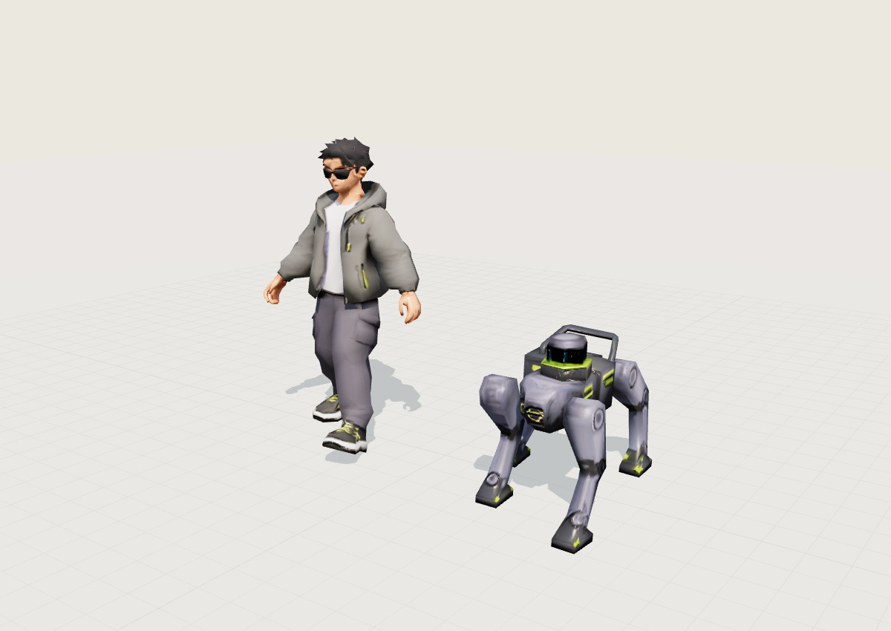
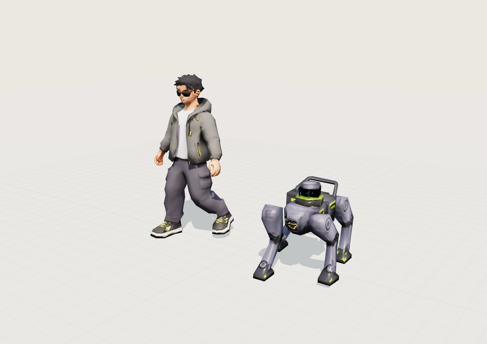
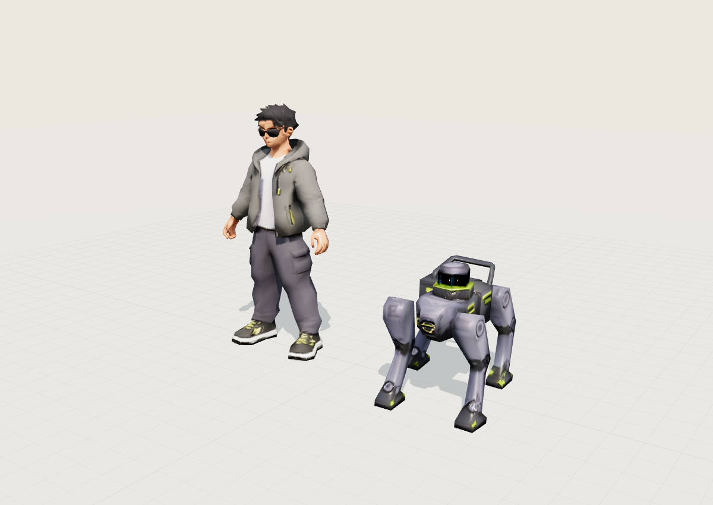
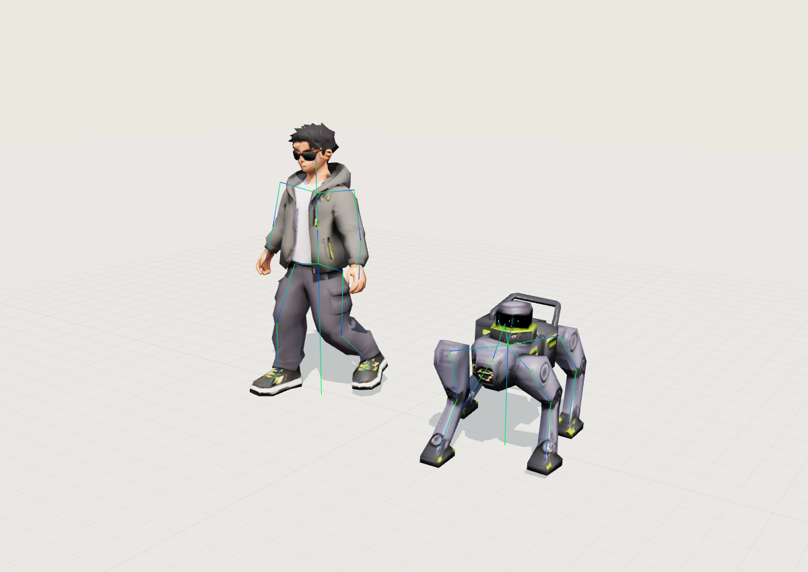
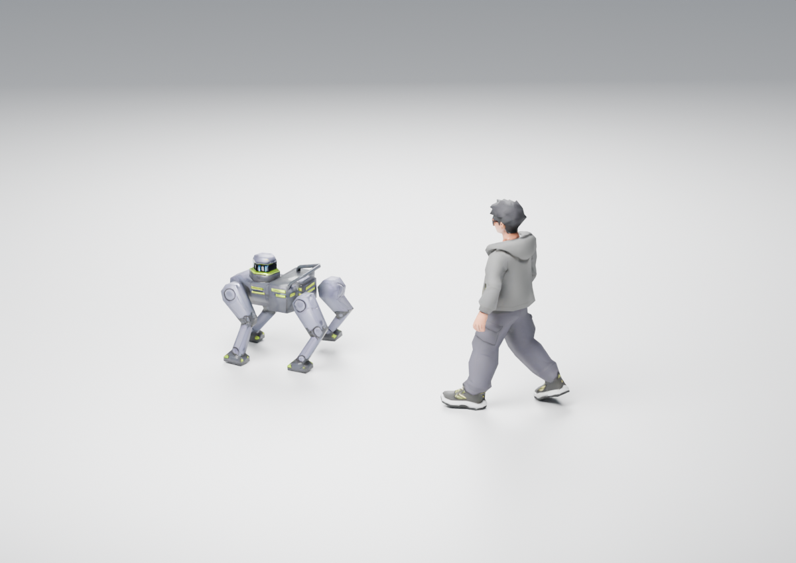

# 现有角色的骨骼动画交付

本次直接给城市包中的原人物和机器狗添加骨架、蒙皮权重及关节动画。两份输入 GLB 原来都没有 `skin`、骨骼或动画；两份输出现在都包含标准 glTF 蒙皮和五组可被 Three.js `AnimationMixer` 播放的动作。

没有换角色或重做外观。原始位置、法线、UV、三角形索引、材质、贴图及其原二进制缓冲均保留；绑定姿态经逆绑定矩阵还原后与原模型一致。动画期间，原模型顶点由真实关节变换驱动。

本轮持绳与绕行更新没有改写 GLB、Blender 工程、骨架、权重或动作文件。下文既有模型数值、预览和步态验证仍对应这些原资产；新增网页运行时持绳已通过独立连接验证，持绳与绕行联动已通过本地和公网浏览器检查。新旧证据分开列示，旧素材预览不代表新增运行时效果。

## 文件和坐标

| 模型 | 输出 | 根节点 | 骨骼 | 绑定姿态高度 |
|---|---|---|---:|---:|
| 人物 | `web/public/city/animated/human.glb` | `BlindPerson_Root` | 20 | 1.80 米 |
| 机器狗 | `web/public/city/animated/dog.glb` | `RobotDog_Root` | 15 | 0.90 米 |

两份文件都使用米制、Y 向上、+Z 为前方，绑定网格 X/Z 包围盒以零为中心，脚底原点 Y=0。不要重复居中、转换 Z-up 或缩放。前端控制原根节点的场景位置和朝向；骨骼动画没有根节点水平位移。

`rig-manifest.json` 记录路径、根节点、坐标、动作时长、基准速度和文件校验和；`validation.json` 是对最终 GLB 独立解析的验证结果。

## 动作和接入

| 动作名 | 人物时长 | 狗时长 | 行为 |
|---|---:|---:|---|
| `idle` | 2.40 秒 | 2.40 秒 | 站立，轻微头部活动，循环 |
| `walk` | 1.20 秒 | 1.12 秒 | 交替抬脚和屈膝，人物配合摆臂，狗四腿错相步态，循环 |
| `turn_left` | 1.20 秒 | 1.12 秒 | 原地短步，内侧步幅略小，循环 |
| `turn_right` | 1.20 秒 | 1.12 秒 | 与左转相反的短步，循环 |
| `stop` | 0.48 秒 | 0.48 秒 | 步幅减小、脚落地，最终与 `idle` 首帧一致，单次 |

加载后为人物和狗分别建立 `AnimationMixer`。建议动作切换使用约 0.18～0.25 秒的淡入淡出；`stop` 采用 `LoopOnce` 与 `clampWhenFinished=true`，结束后切到 `idle`。动作是原地动画，路线控制器仍负责角色整体位移和转弯角度，不能再叠加动画根位移。

为减少滑步，行走动作的 `timeScale = 当前场景移动速度 / nominal_walk_speed_mps`。人物基准速度约 **0.913978 米/秒**，狗约 **0.395408 米/秒**。两者步频可以不同；`idle`、`stop` 不要乘以移动速度。移动转弯时继续播放已标定的 `walk` 并调整根节点朝向；短步 `turn_left/right` 只用于停止位移后的原地转向。当前路线 1.2 米/秒时，人物 `timeScale≈1.31294`、实际循环约 **0.914 秒**，约 **131.3 步/分**，每步前进约 **0.548 米**。

正式版本采用经对照审阅的 0.68 米局部足部行程。`gait.stride_m` 指脚在支撑阶段相对身体的前后行程，不是现实单步长度；支撑占比为 0.62。原 0.42 米版本在相同路线速度下约 212.6 步/分，已由这版替换。0.70 米版本仅用于比较，未纳入生产模型。

## 运行时持绳与绕行接入

`web/lib/guide-connection.ts` 在模型加载后生成胸背带、握环和导盲绳。人物握点挂在左手骨骼 `human_hand_L` 下，机器狗锚点挂在躯干骨骼 `dog_body` 下；每帧取得两端世界坐标更新绳段，并保留轻微下垂。胸背带和握环随各自骨骼移动，不依赖固定世界位置。

人物动画混合后对左肩、左肘、左手施加持绳姿态，右臂继续随步态运动。这个姿态是网页运行时覆盖，不是新增或替换 GLB 动作；直接在 Blender 或独立 GLB 查看器中打开资产，不会自动出现网页的胸背带、绳子或持绳姿态。

人物和狗都沿服务端 `state.navigation.points` 的同一条路径定位，人物沿路径弧长落后狗 **2.2 米**；绕行后仍使用新路径和相同间距，不沿原直线追赶。开始时人物位于路线起点后方的延长线上。路线负责整体位移与朝向，原地动作负责步态；绕行总长按新路径弧长计算。

导盲绳采用可重复使用的几何段显示两端连接，属于演示视觉效果，没有弹性、张力、人体受力或绳子与城市场景的物理碰撞求解。固定障碍及静态碰撞轮廓的路径净空由演示服务负责；模型动作验证、路径净空检查和浏览器持绳画面验收各自覆盖不同范围。

本轮导盲连接验证覆盖 **19,667 帧、96 个动作与过渡用例**，检查实际人狗 GLB、握持姿态、骨骼锚点、绳段连续性、角色根位置及原路线和绕行的队形。结果通过，数值见[导盲连接验证](verification/guide-connection-validation.json)；其范围是水平地面及路线队形，不覆盖手指精细抓握或绳子与任意物体碰撞。

本地浏览器完成两次绕行并到达 152.2156 米；公网浏览器完成一次绕行、途中暂停及刷新恢复，最终到达 151.1078 米，障碍仍保留，控制台无警告或错误。见[公网持绳绕行画面](screenshots/guide-detour-public.png)、[公网到达画面](screenshots/guide-public-arrival.png)和[本轮验收汇总](verification/guide-detour-release.json)。下文旧版素材预览继续用于检查原资产。

随后降低了跟随相机高度，增加前方街道视野，同时保留握点、胸背带和绳子。已完成本地完整路线、桌面与窄屏画面检查，以及最终公网绕行、暂停和视角切换，见[公网低视角画面](screenshots/guide-low-camera-public.png)。手机布局的小地图移至左下。原公网完整路线日志形成于相机微调前；这次浏览器检查不扩展为新增物理手机实测。

## 制作方法与限制

- 人物建立骨盆、脊柱、胸、头颈、双臂和双腿链；腿部使用两段逆运动学生成足部轨迹，髋、膝、踝都参与旋转。衣物与身体共享原网格，通过空间分区和关节过渡权重驱动。
- 人物行走加入脚跟落地与脚尖蹬地，脚掌世界俯仰为脚尖上翘 22°到蹬地 20°；根据原鞋底实际接触顶点补偿踝关节高度和前后位置。相比原步态，髋部只额外降低 4 毫米。100001 相位可达范围检查中，扣除 IK 安全量后最小腿长余量 1.441 毫米；721 相位测得最大膝弯约 67.9°，大腿偏离竖直最多约 45.5°，没有伸长骨段。
- 本次步频调整仅改变人物 `walk`；人物其他四组动作、骨骼、蒙皮权重逐项保持一致，机器狗 GLB 逐字节保持不变。
- 狗原模型焊接位置分析后有八个连通块，四条腿各自独立；躯干与头部主要采用刚性权重，腿只在膝和踝附近过渡，尽量保留金属外壳形状。
- 原狗模型四只脚高差约 5.2 厘米。动画以骨骼姿态小幅调整脚部接地，未改原始网格。站立时最高残留脚底间隙约 0.7 毫米。
- 这是为现有低多边形模型制作的演示级骨骼步态，并非动作捕捉或机器人动力学仿真。人物为 1,341 个三角面，狗为 379 个三角面；大幅近景动作仍受原拓扑限制。
- 较大步幅会加重原裤裆权重牵拉：一条原长 5.831 厘米的局部边，动画最大长度从约 11.892 厘米增至 13.246 厘米。正面、侧面及城市视角已复核，未见新增明显尖刺，但膝部仍有多边形折线；不应把结果描述为布料模拟。三栏对照图、六秒近景/城市视频与数值记录保存在 `docs/verification/gait-study/`。
- 离线步态按水平地面生成。前端现包含动画混合后的逐脚防下穿约束，适用于这批模型和城市道路薄层高差；不包含楼梯攀登、全身动力学、持续水平脚锁或人物碰撞响应。随机相位急停仍有短暂收步，不能把“脚不穿地”等同于动作捕捉级的零滑步。

## 运行时贴地和过渡

单个动作接地，不代表两个动作淡入淡出后的姿态也接地。补测真实 `THREE.AnimationMixer` 后，发现固定 `stop` 首帧与任意行走相位混合会使脚底短暂下穿。现在 `web/lib/foot-contact.ts` 在动画混合后测量实际蒙皮鞋底点（人物 20 点、狗 15 点），向真实城市地面射线查询高度，再通过现有髋—膝—踝链抬起穿地的脚。修正保留脚的世界旋转、骨段长度和角色根位置，不通过抬高整个人来掩盖问题。

每次 `AnimationMixer.update()` 前显式恢复上一帧约束前的腿骨旋转。Three.js 对数值未变化的动画轨道可能跳过写入，因此这一步保证站立和重复相位也不会累积 IK 修正。动画仍驱动所有原始网格，UV 和贴图不变。

独立脚本 `scripts/rig-transition-validate.mjs` 使用最终 GLB、真实 Three.js 混合器和前端同一份约束代码，保存 `transition-validation.json`。它在 16 个相位、60/120Hz、平地/12毫米道路薄层高差下检查起步、停车、停车中恢复、左右转、转回站立，共 768 组，并进行 240 次常量站立轨道恢复检查。验证对象为完整蒙皮网格，不是只看骨骼端点。新步态约束后全套测试最低离地 **0.971 毫米**，角色根不变、骨段不拉长；未约束混合可下穿数厘米。

Chrome 近景已检查新模型 37.5% 步态相位停车的中间帧：第 0.10 秒需约 **31.3 毫米**足部修正，脚掌正常贴地，躯干没有随修正上下跳动。测试页可以切换约束开关和路线步频、逐帧查看混合。

真实 Three.js 中以 1.2 米/秒移动根节点，在稳定支撑阶段追踪同一个近地鞋底顶点，人物接地点水平残速平均约 **0.0066 米/秒**、P95 约 **0.0374 米/秒**。原版平均约 0.00085 米/秒；脚掌滚动插值增加小幅残速，不能宣称绝对零滑步。详细过滤口径见 `docs/verification/gait-study/accepted-support.json`。

此前在贴地约束接入后、步频调整前测量过实际城市场景：桌面 Chrome、Next 开发模式、390px 视口中，两角色的 35 次地面射线与 IK 平均约 0.93～0.97 毫秒，P95 约 1.0～1.1 毫秒。数据在 `web/public/city/animated/city-performance.json`；这是旧步态时的主线程基准，不是新版本或物理手机帧率承诺，也不是 GPU 独立耗时测试。临时测量代码已移除。

## 验证与预览

已经在 Chrome/Three.js 中加载最终 GLB，检查起步、中步、停步、侧面、转向与骨架覆盖图。原衣服、面部、眼镜、鞋与机器狗贴图均保留，关节驱动可见；原模型未被通用替身替换。

独立验证器对最终 GLB 以 60Hz 插值采样，检查了：

- 蒙皮权重合法且归一化，关节索引和逆绑定矩阵有效。
- 绑定姿态还原原模型，原始几何、UV、法线、索引和贴图二进制保持一致。
- 五个动作均存在；循环首尾一致；停步结束等于站立首帧。
- 膝腿产生真实关节运动，人物步行最大顶点位移约 **66.7 厘米**，狗约 **31.0 厘米**；并非仅整体上下浮动。
- 人物步行抬脚约 9.6 厘米，狗约 7.5 厘米。单个动作 60Hz 插值下最大脚底下穿约 **0.64 毫米**，在 4 毫米检查容差内；网页另有 3 毫米放置余量和运行时约束，混合动作的额外验证见上节。

预览由同一批最终 GLB 的浏览器 WebGL 画面导出，每张 1200×850：









## 复现

在项目根目录执行，Python 需要 NumPy：

```sh
python3 scripts/rig-models.py
python3 scripts/rig-validate.py
node scripts/rig-transition-validate.mjs
python3 scripts/rig-preview-server.py
```

最后一条命令只监听本机 `127.0.0.1:8876`。打开 `http://127.0.0.1:8876/scripts/rig-preview.html`，可以切换动作、人物/狗、视角和骨架。点击“保存当前预览”将 PNG 写入 `web/public/city/animated/previews/`。此工具只用于本机检查，不加入生产页面。

脚本直接写入标准 glTF skin、`JOINTS_0`、`WEIGHTS_0`、逆绑定矩阵和关节关键帧，因此生成 GLB 本身无需 Blender。

## 可编辑 Blender 工程

本次已从官方分发地址安装 Blender **5.2.2 LTS**，在本机用户的 `Applications/Blender.app` 下。将最终 GLB 导入后，另存为 `source-assets/characters/Furward_Characters_Animated.blend`，便于建模同学继续编辑。原城市工程保持保留。

工程中人物为 20 根骨骼、狗为 15 根骨骼；两者各保留五组原地动作，六张图片全部打包。NLA 中加入按实际速度播放的行走预览，父节点负责直线移动。摄像机、光照与灰色检查地面只用于预览，不写回网页模型。

按网页的 **1.2 米/秒**速度，以 **60Hz**采样 **121 帧**，两角色均走过 **2.4 米**；最低脚底高度分别为 **2.353 毫米、2.693 毫米**（包含 3 毫米放置余量）。保存后已重新打开 `.blend`，确认动作、骨骼和打包贴图仍在。数值记录于 `source-assets/characters/blender-validation.json`。

这项检查覆盖直线步态；网页起停混合和城市逐脚贴地由上文运行时代码及过渡回归验证。两者不能互相替代。

```sh
blender --background --python-exit-code 1 --python scripts/build-blender-review.py
```

在 Blender 中打开文件后按空格播放。编辑其他动作前先静音 NLA 的 `REVIEW — 1.2 m/s walk` 轨道，详细说明见 `source-assets/characters/README.md`。


